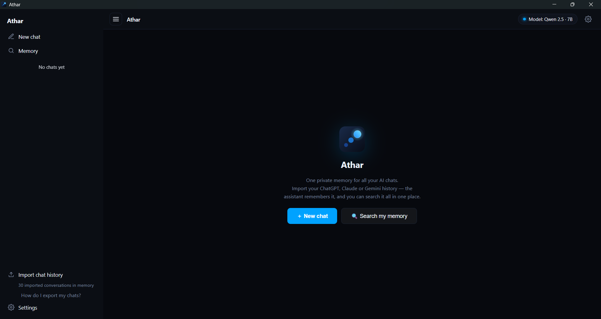

# Athar

**One private memory for all your AI chats.** Import your ChatGPT, Claude and Gemini
history into Athar, search all of it in one place, and let an AI answer with what you
discussed before, citing the conversations it used. Your history stays on your computer.

Athar (أثر) means "trace": what your past conversations leave behind.



Copyright (C) 2026 Makarious Robert. Free and open source under the
[GNU AGPL v3](#license).

## What it does

- **One memory across assistants.** Conversations from ChatGPT, Claude, Gemini and
  Athar's own chats are split into passages and searched by meaning and by keywords.
  For each message, the relevant memories are given to the AI, which cites them like
  `[M1]`; questions that have nothing to do with your history get none.
- **Understands how you ask.** "What did I ask Claude about my salary last year?"
  searches only Claude, only last year, for "salary". "Summarize my last chat" or
  "the chat about the bakery database" answers from that one conversation.
- **Search and browse your history.** The Memory view lists every conversation,
  filters by source, opens a conversation at the matching passage, and starts a new
  chat about it. Files that Claude created or edited in your chats are rebuilt and
  shown as cards you can open.
- **Answers with a local model or Gemini.** Run a free model on your own computer
  through [Ollama](https://ollama.com), or use Google's Gemini with your own free API key.
- **Your memory inside Claude.** Athar is also an MCP server: connect Claude Desktop
  with one click (or Claude Code with one command), and Claude can search and read your
  Athar memory while you chat with it, using the Claude plan you already have.
- **Memory profile.** A short summary of you (work, projects, tools, how you like
  answers) learned from your own messages. Review it, use it in Athar, or copy it into
  another assistant's custom instructions.
- **Web search only when you turn it on.** The **Search** button in the message box
  (off by default) lets capable models search the web and open links. With it off,
  nothing goes online to answer you.
- **Attach files** (PDF, text, code) and ask about them; **attach a project folder**
  (read-only) to ask about its files and Git history. Athar never changes your files.
- **You stay in control.** Delete chosen conversations, clear all imported history,
  or remove one source at any time.

## Requirements

- **Windows 10 or 11 (64-bit).** The installer is built for Windows. The code also
  builds for macOS and Linux, but those are untested, and the graphics card check and
  the automatic Ollama install are Windows-only.
- **Internet** for the first setup (downloads), for Gemini and for web search.
  With a local model, Athar works fully offline afterwards.

What else you need depends on how Athar answers you:

| Choice | What you need |
|---|---|
| **Local model** | [Ollama](https://ollama.com) (Athar installs it for you), a chat model and the `bge-m3` search model (1.2 GB), downloaded at setup. Memory depends on the model; see below. |
| **Gemini** | A free API key from [aistudio.google.com/apikey](https://aistudio.google.com/apikey). Any PC works. |
| **Claude** | [Claude Desktop](https://claude.ai/download) or Claude Code, with your own Claude plan. Athar's own chat window then needs Gemini or a local model too, but importing and searching your history work without one. |

**Search by meaning** needs Ollama with `bge-m3`, whichever way you choose. Without
it, Athar searches by keywords.

### How much memory a local model needs

Athar lists every chat model in the Ollama library, in every size (about 380), with what
each needs. It reads your computer's RAM and graphics card and marks each model as
**fast on your graphics card**, **slower** (runs partly on the processor), **tight on
memory**, or **too big**, and hides the ones that are too big. It recommends the
strongest of these that runs fast on your graphics card:

| Model | Download | Graphics memory (fast) | RAM without a graphics card |
|---|---|---|---|
| Qwen 3 14B | 8.6 GB | 12.1 GB | 16.9 GB |
| Qwen 2.5 7B | 4.4 GB | 6.0 GB | 9.0 GB |
| Qwen 3 4B | 2.3 GB | 5.2 GB | 8.2 GB |
| Qwen 2.5 3B | 1.8 GB | 3.0 GB | 5.2 GB |
| Qwen 3 1.7B | 1.3 GB | 3.6 GB | 6.1 GB |

Figures are for Athar's full 16K-token chat context. Models of about 14B parameters
and up can also search the web (with Search on).

## Getting started

1. **Install.** Download `Athar Setup <version>.exe` from the
   [Releases](../../releases) page and run it. The installer isn't code-signed yet, so
   Windows may show "Windows protected your PC": choose **More info → Run anyway**.
2. **Choose how Athar answers you.**
   - **Local model:** Athar finds or installs Ollama, then downloads the recommended
     model for your computer (or one you pick) and `bge-m3`.
   - **Cloud model → Gemini:** paste your free Gemini API key.
   - **Cloud model → Claude:** connect Claude Desktop (one click) or copy the command
     for Claude Code.

   You can change or add another any time in **Settings**.
3. **Import your history.** Export your chats from each service, then click
   **Import chat history** at the bottom of the sidebar and choose the file (or drag it
   there). **How do I export my chats?** under that button opens a step-by-step guide.

   | From | Export in | File to import |
   |---|---|---|
   | ChatGPT | Settings → Data controls → Export data | `conversations.json` |
   | Claude | Settings → Privacy → Export data | `conversations.json` |
   | Gemini | [Google Takeout](https://takeout.google.com) → My Activity → Gemini Apps, format **JSON** | `MyActivity.json` |

   The export arrives by email as a zip: extract it first. Importing a newer export
   later only adds new and changed conversations. Indexing for search by meaning runs
   in the background (newest first); you can use Athar meanwhile.
4. **Ask.** Start a new chat and ask about anything you discussed before, or open
   **Memory** to search and browse.

## Using Athar

### Chat

Ask normally; Athar searches your memory for every message and the answer cites what it
used (`[M1]`, `[M2]`…). The conversations found appear as chips under the answer: click
one to open it at the matching passage. Attach files with the
paperclip, and turn on **Search** to let the model use the web for questions about
things that change.

### Memory

- **Search** in plain words; dates and sources in the query are understood ("in Claude",
  "last month").
- **Filter** by source, open any conversation, **Copy** it, or **Ask about this** to
  start a chat with it attached.
- **Delete:** open a conversation and choose **Delete**, or choose **Select**, tick
  conversations and delete them together. **Clear all imported history** removes every
  imported conversation. Your export files aren't touched, so importing again brings
  them back. Deleting a chat made in Athar deletes that chat.
- **Memory profile:** build a short summary of you from your messages, edit it, and use
  it in Athar or copy it elsewhere.

### Models

Open **Settings** to switch model, download another local model, add a Gemini key, or
connect Claude. With a Gemini model, if it reaches its free limit, another Gemini model
answers. Features a model can't do (images, tools) are switched off and explained.

### Your memory in Claude Desktop and Claude Code

In **Settings → Use your memory in Claude**:

- **Claude Desktop:** click **Connect**, then quit Claude Desktop completely (right-click
  its tray icon → Quit) and open it again. "athar" appears under Claude's Settings →
  Developer and in its tools menu.
- **Claude Code:** copy the `claude mcp add …` command shown and run it once in a terminal.

Claude then has three read-only tools: `search_memory`, `list_conversations` and
`read_conversation`. Claude Desktop starts a hidden Athar process when it starts (about
180 MB) and stops it when it quits; the Athar window doesn't need to be open. Chats you
have in Claude don't come back into Athar on their own: import a newer Claude export.

## Privacy

Your imported history, chats, memory profile and files stay on your computer, in
`%APPDATA%\Athar`. Athar has no server and sends nothing to its author. What goes
online is limited to what you choose:

- **Gemini:** your question, the conversation and the relevant excerpts of your memory
  and files go to Google. On Google's free plan, Google may use them to improve its
  products.
- **Claude:** only what Claude looks up in your memory goes to Anthropic, as part of
  your Claude chat.
- **Search on:** search words go to DuckDuckGo (or Google Search with Gemini 3+), and
  pages are opened like a browser would.
- **Downloads:** Ollama and models come from ollama.com and its model library.

Your Gemini API key is stored encrypted with Windows' own protection. The full details
are in [PRIVACY.md](PRIVACY.md), also in the app under **Settings → Privacy**.

## Building from source

Needs [Node.js](https://nodejs.org) 22 or newer.

```bash
npm install
npm start            # run Athar from source
npm test             # offline tests (no Ollama or internet needed)
npm run test:live    # also tests that use Ollama and the internet
npm run release      # tests → notices → Windows installer in dist/ → smoke test
```

`npm run release` options: `--skip-tests`, `--no-smoke`. `npm run dist` builds without
tests or the smoke test. Both use electron-builder (see `build` in `package.json`), with
Electron fuses on: the installed app refuses to start if its files are modified. They
regenerate `THIRD-PARTY-NOTICES.txt` from the shipped dependencies. Update `version` in
`package.json` for each release.

**Refreshing the model list:** `node scripts/update-model-catalog.js` rebuilds
`src/renderer/model-catalog.js` from Ollama's library: exact download sizes from the
registry, and each model's architecture (layers, attention heads, context length) from
its file, from which the memory needs are worked out.

**Overrides** (environment variables): `ATHAR_ASSIST=guided|light` (how much the app
guides the model), `OLLAMA_NUM_CTX=<tokens>` (context size), `OLLAMA_KEEP_ALIVE`.

### How local models are handled

Athar reads each model's description from Ollama (`src/main/ollama/model-profile.js`)
and adapts, so any installed model works:

- **Capabilities:** tools, images and "thinking", as Ollama reports them.
- **Context size:** the largest of 16K, 8K or 4K tokens that fits in the computer's
  memory next to the model, never more than the model supports.
- **Guidance:** models under about 14B parameters get more help from the app; larger
  ones decide more on their own.
- **Thinking models** (Qwen 3, DeepSeek R1…): their reasoning is hidden while they
  answer and removed from the answer.

### Project structure

```
src/main/                 Electron main process
  index.js                window, navigation lock, "--mcp" mode
  ipc-handlers.js         routes the window calls (only Athar's own page may call them)
  cloud/                  Gemini (your API key, model list, limits and fallback)
  hardware.js             RAM and graphics card, to show which models fit
  mcp/                    "Athar --mcp": memory tools for Claude Desktop / Claude Code
  memory/                 passages, keyword + meaning search, query hints, profile
  ollama/                 Ollama client, model profiles, agent loop, Ollama installer
  parser/                 ChatGPT / Claude / Gemini exports, PDF and text files
  store/chat-store.js     chats made in Athar
  tools/                  attached files, project folder, Git, web search (read-only)
src/preload/preload.js    the bridge between the window and the main process
src/renderer/             the interface (HTML, CSS, JavaScript), model list, export guide
scripts/                  release build, open-source notices, model list update
tests/                    test suites (npm test)
```

## Known limitations

- Local models, especially small ones, can misremember or over-generalize. Answers cite
  the conversations they used so you can check, and the memory profile is meant to be
  reviewed before you use or share it.
- Getting your history needs a manual export from each service; there's no official
  way to sync it automatically.
- The interface is in English. Answers follow the language you write in, including Arabic.
- Windows only for now (see Requirements).

## License

Athar — one private memory for all your AI chats
Copyright (C) 2026 Makarious Robert

This program is free software: you can redistribute it and/or modify it under the
terms of the GNU Affero General Public License as published by the Free Software
Foundation, either version 3 of the License, or (at your option) any later version.

This program is distributed in the hope that it will be useful, but WITHOUT ANY
WARRANTY; without even the implied warranty of MERCHANTABILITY or FITNESS FOR A
PARTICULAR PURPOSE. See the GNU Affero General Public License for more details.

You should have received a copy of the GNU Affero General Public License along with
this program (see [LICENSE.txt](LICENSE.txt)). If not, see
<https://www.gnu.org/licenses/>.

In short: you may use, study, change and share Athar. If you share a changed
version, or run one for others over a network, you must release its source code
under the same license and keep this copyright notice.

Athar includes open-source components under their own licenses, and uses Ollama,
AI models, Gemini and Claude under their own terms; all are listed in
[THIRD-PARTY-NOTICES.txt](THIRD-PARTY-NOTICES.txt). "Athar" and its icon identify
this project; please give a changed version a different name.

Questions: mekorobert2010@gmail.com
